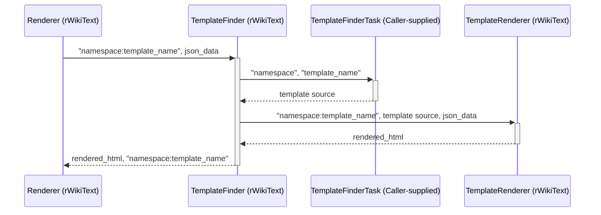

# Replace static `wiki_data` template lists with `TemplateFinder`, `TemplateFinderTask`, and `TemplateRenderer`

rWikiText previously relied on a caller-supplied `wiki_data` template list (via `WikiData::template_text` and CLI `--wiki-data` JSON `templates`) to fetch raw wikitext and expand templates inside the converter, while excluding NamuMark `[include(...)]` from callbacks altogether. We remove the static `wiki_data` template list model and instead require the parser/renderer to unconditionally request templates whenever it encounters MediaWiki `{{...}}` or NamuMark `[include(...)]`, using an internal `TemplateFinder` and `TemplateRenderer` pipeline backed by a caller-supplied `TemplateFinderTask` callback.

## Sequence overview

## Decision

1. **Unconditional transclusion lookup**: Whenever the parser encounters MediaWiki `{{...}}` (excluding built-in parser functions and magic words) or NamuMark `[include(...)]`, it unconditionally triggers template resolution through `TemplateFinder`.
2. **Remove `wiki_data` template lists**: The static `wiki_data` template list / `WikiData::template_text` lookup model is removed.
3. **Component responsibilities (provisional names)**:
   - **`Renderer` (rWikiText)**: Normalizes the requested template identifier under MediaWiki title rules for both MediaWiki `{{...}}` and NamuMark `[include(...)]` (e.g., `Template:` namespace prefix when unqualified, canonical namespace casing, spaces replaced with `_`, and first-character capitalization), and calls `TemplateFinder` with `"namespace:template_name"` and `json_data` (the template arguments/parameters as JSON).
   - **`TemplateFinder` (rWikiText)**: Splits the qualified identifier into `("namespace", "template_name")` and invokes the caller-supplied `TemplateFinderTask` to obtain the `template source`. It then passes `"namespace:template_name"`, `template source`, and `json_data` to `TemplateRenderer`, and returns `rendered_html` together with `"namespace:template_name"` to `Renderer`.
   - **`TemplateFinderTask` (Caller-supplied)**: The callback registered by the external caller/developer. It accepts `("namespace", "template_name")` and returns the corresponding `template source` (or reports missing / lookup error).
   - **`TemplateRenderer` (rWikiText)**: Renders `template source` with `json_data` into `rendered_html`, embedding metadata for `"namespace:template_name"` and `json_data`.
4. **Embedded HTML metadata for reverse conversion**: The `rendered_html` produced by `TemplateRenderer` carries metadata (meta tag / metadata payload) containing `"namespace:template_name"` and `json_data`. When converting HTML to another markup format (MediaWiki wikitext, NamuMark, GFM, etc.), the converter reads this metadata to recover the template invocation and its arguments.
5. **Fallback and error handling**: If no `TemplateFinderTask` is registered or it reports that the template is missing, conversion does not abort; it retains fallback output and records a located `ConversionLoss` diagnostic (which strict mode rejects). If `TemplateFinderTask` reports a lookup error, conversion aborts so the caller can decide whether to retry.

## Reusing the existing renderer in `TemplateRenderer`

`TemplateRenderer` reuses rWikiText's existing markup-to-HTML conversion core (`src/pipeline.rs`, `src/render.rs`, `src/html_policy.rs`) and HTML transclusion-annotation pattern (`src/transclusion.rs`) rather than introducing a separate rendering engine. Because the existing renderer targets standalone full-document conversion, `TemplateRenderer` wraps it with five template-specific responsibilities:

1. **Parameter substitution and inclusion-tag preprocessing**: Apply MediaWiki `<onlyinclude>` / `<noinclude>` / `<includeonly>` filtering and `{{{...}}}` substitution, or NamuMark `@param@` / `@param=default@` substitution from `json_data`, before invoking the core parser/renderer.
2. **Template source format selection**: Determine whether `template source` is parsed as MediaWiki wikitext or NamuMark (e.g., matching the enclosing document format or explicit format metadata).
3. **Inline vs. block fragment rendering**: Support rendering inline template invocations without wrapping single-paragraph output in an outer `
...
`.
4. **Shared expansion limits across nested transclusions**: Propagate `ExpansionLimits` (`max_depth`, `max_expansions`, `max_output_bytes`) across nested `TemplateRenderer` → `TemplateFinder` re-entry to prevent unbounded recursion.
5. **Parent-document state coordination**: Define how heading-ID deduplication and template-emitted `PageMetadata` (such as categories) are isolated from or merged into the enclosing document.

## Consequences

- **Supersedes parts of [ADR 0002](0002-versioned-c-abi-and-wiki-data-callbacks.md)**: Replaces the `WikiData::template_text` / static `wiki_data` template-list model and supersedes the rule that NamuMark input invokes no wiki-data callbacks for `[include(...)]`.
- **Updates [ADR 0001](0001-parsoid-and-document-fidelity.md) template round-tripping**: Template recovery from HTML relies on the embedded `"namespace:template_name"` and `json_data` metadata produced by rWikiText's `TemplateRenderer`.
- **Clear boundary between library and caller**: `Renderer`, `TemplateFinder`, and `TemplateRenderer` all live inside rWikiText. Callers only implement `TemplateFinderTask("namespace", "template_name") -> template source` without handling template arguments or HTML metadata.
- **ABI and bindings**: Replacing `template_text(title)` with `TemplateFinderTask(namespace, template_name)` is an incompatible change to ABI v1 and must be versioned accordingly when implemented.
- **Implementation status**: This ADR records the accepted target architecture. The shipped `v1.0.x` codebase still implements the previous `WikiData::template_text` / `--wiki-data` model and excludes NamuMark `[include(...)]` until the migration is implemented.
