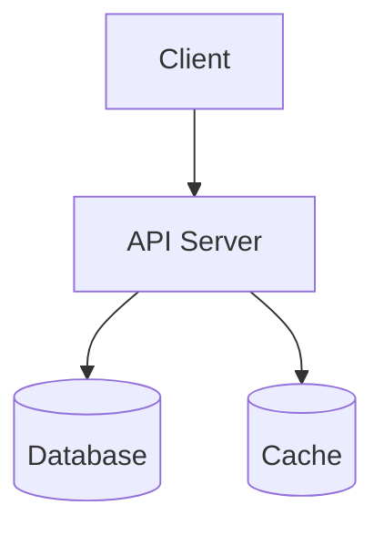

# README 작성 및 유지보수 가이드

## 1. 목적

이 문서는 소프트웨어 개발 에이전트가 Git 레포지토리의 `README.md`를 신규 작성하거나 개선할 때 적용할 작업 지침이다.

README는 프로젝트의 소개 페이지(Landing Page), 빠른 시작 가이드(Quick Start), 기술 문서 인덱스(Documentation Index)의 역할을 수행해야 한다. 처음 접하는 사용자 및 개발자가 프로젝트의 목적, 기능, 지원 범위, 실행 방법과 기여 방법을 별도의 도움 없이 파악할 수 있도록 작성한다.

## 2. 기본 원칙

- **명확성(Clarity)**: 프로젝트가 무엇이며 어떤 문제를 해결하는지 구체적으로 설명한다.
- **간결성(Conciseness)**: 불필요한 수식어, 마케팅 문구, 중복 설명을 제거한다.
- **재현성(Reproducibility)**: 명시된 사전 요구사항과 절차를 따르면 프로젝트를 실행할 수 있어야 한다.
- **정확성(Accuracy)**: 모든 기술적 설명은 실제 소스코드, 설정, 테스트 및 배포 구성을 근거로 작성한다.
- **탐색성(Discoverability)**: 사용자가 필요한 문서와 리소스를 쉽게 찾을 수 있도록 구성한다.
- **유지보수성(Maintainability)**: 자주 변경되는 정보의 중복 기재를 피하고 단일 정보 출처를 유지한다.
- **접근성(Accessibility)**: 특정 플랫폼, 개발 환경 또는 사전 지식을 근거 없이 전제하지 않는다.

## 3. 에이전트 작업 절차

### 3.1. 레포지토리 분석

README를 작성하기 전에 실제 레포지토리를 분석한다. 다음 항목은 존재하는 경우에만 검사한다.

- 기존 `README.md`, `docs/`, `AGENTS.md` 및 프로젝트별 작업 지침
- 소스코드 구조, 진입점, 핵심 모듈, 공개 API 및 CLI
- 패키지 매니페스트, 잠금 파일, 런타임 및 빌드 설정
- `Dockerfile`, Compose 파일, 배포 매니페스트 및 서비스 정의
- `.env.example`, 설정 스키마, 기본값 및 필수 설정
- 테스트 코드, 테스트 실행 스크립트, CI/CD 워크플로우
- 릴리스 및 버전 정책, `LICENSE`, `CONTRIBUTING.md`, `SECURITY.md`

기존 문서의 유효한 정보와 프로젝트의 언어·표기 관례를 보존한다. 코드, 설정 및 문서 사이에 불일치가 발견되면 확인 가능한 사실을 우선하고, 판단이 어려운 사항은 별도로 보고한다.

### 3.2. 작성 범위 결정

프로젝트 유형과 주요 독자를 식별하고 필요한 섹션을 선택한다. 범용 템플릿의 모든 섹션을 기계적으로 삽입하지 않는다. 내용이 없거나 중복되는 섹션, 실제로 존재하지 않는 기능이나 문서에 대한 섹션은 생략한다.

### 3.3. 작성 및 검증

1. 프로젝트명, 한 줄 설명 및 핵심 기능을 정리한다.
2. 프로젝트에 적합한 최소 실행 또는 사용 예제를 구성한다.
3. 실제 요구사항, 설정, 호환성 및 기술적 제한을 확인한다.
4. 필요한 상세 문서와 레포지토리 리소스를 연결한다.
5. 권한과 실행 환경이 허용되는 범위에서 명령어, 예제 및 링크를 검증한다.
6. `README.md`를 작성하거나 기존 문서를 수정한다.
7. 변경 내용, 검증 결과 및 미확인 사항을 요약한다.

## 4. README 권장 구조

다음 순서를 기본값으로 사용하되, 프로젝트 유형과 규모에 맞게 조정한다. 필수 항목은 해당 정보가 적용되는 프로젝트에서 제공해야 하며, 하나의 섹션으로 통합해도 된다.

| 섹션 | 중요도 | 작성 내용 |
| --- | --- | --- |
| Header | 필수 | 프로젝트명, 한 줄 소개, 선택적 로고·배지·주요 링크 |
| Overview | 필수 | 개발 목적, 해결하려는 문제, 주요 사용 대상 |
| Project Status | 권장 | 개발 성숙도, 안정성, 유지보수 상태 |
| Features | 권장 | 현재 제공하는 주요 기능 및 차별점 |
| Demo / Screenshots | 선택 | 실제 동작 화면 또는 데모 |
| Quick Start | 필수 | 최소 실행 또는 사용 절차 |
| Requirements | 필수 | 지원 환경 및 필요한 의존성 (Quick Start 전에 안내하거나 그 안에 포함) |
| Installation | 권장 | 지원하는 설치·배포 방법 |
| Usage | 필수 | 대표 사용 사례 및 실행 예제 |
| Configuration | 권장 | 설정 파일, 환경변수 및 기본값 |
| Architecture | 권장 | 고수준 시스템 구조 및 핵심 구성요소 |
| Documentation | 권장 | 상세 문서 및 API 레퍼런스 링크 |
| Development | 권장 | 개발 환경, 빌드 방법 |
| Testing | 권장 | 테스트 실행 방법 |
| Roadmap | 선택 | 확인된 향후 개발 계획 |
| Contributing | 권장 | 기여 방법 및 관련 규칙 |
| Security | 권장 | 보안 정책 및 취약점 신고 방법 |
| License | 필수 | 확인된 라이선스 또는 라이선스 미확인 상태 |
| Acknowledgements | 선택 | 기여자 및 관련 프로젝트 |

## 5. 섹션별 작성 지침

### 5.1. Header / Overview

- 프로젝트명은 최상위 제목(`#`)으로 작성한다.
- 한 줄 설명은 구현 언어나 기술 스택만 나열하지 않고 프로젝트의 역할을 나타낸다.
- Overview에는 프로젝트의 목적, 해결하려는 문제, 주요 사용 대상 및 확인된 차별점을 기술한다.
- 로고와 배지는 선택 사항이다. 빌드 상태, 릴리스, 라이선스, 테스트 커버리지 등 실제로 존재하고 확인 가능한 정보만 표시한다.
- 공식 문서, 릴리스, 데모 등 주요 링크는 유효한 경우에만 제공한다.

### 5.2. Features / Project Status

- 현재 구현되어 있는 기능과 향후 계획을 명확히 구분한다.
- 기능은 사용자 관점의 효용과 구체적인 기술적 특성으로 설명한다.
- '빠른', '강력한', '최고의', '높은 확장성' 등 근거 없는 정성적 표현을 사용하지 않는다.
- 성능 수치를 제시할 때는 측정 환경, 방법 및 결과의 출처를 제공한다.
- Experimental, Alpha, Beta, Stable, Maintenance, Deprecated, Archived 등의 상태는 프로젝트에서 확인된 경우에만 명시한다. 에이전트가 임의로 안정성을 선언하지 않는다.

| 지양하는 표현 | 권장하는 표현 (실제 지원하는 경우) |
| --- | --- |
| 빠른 처리 속도 | 비동기 병렬 요청 처리 지원 |
| 강력한 보안 | OIDC 및 RBAC 지원 |
| 뛰어난 확장성 | Stateless 수평 확장 지원 |
| 편리한 스토리지 | S3 호환 객체 스토리지 및 로컬 파일시스템 지원 |
| 높은 호환성 | MediaWiki Action API 호환 범위 명시 |

### 5.3. Requirements / Quick Start / Installation

- 지원 OS, CPU 아키텍처, 런타임, 외부 서비스 및 필요한 도구를 명시한다.
- 최소 사양과 권장 사양은 검증된 경우에만 구분하여 기재한다.
- Quick Start는 사용자가 가장 짧은 경로로 실제 동작을 확인할 수 있도록 작성한다.
- 명령어 실행 위치, 필수 사전 설정, 접속 주소 또는 예상 결과를 필요한 만큼 설명한다.
- 가능한 경우 하나의 코드 블록으로 완결되는 예제를 제공한다. 운영체제나 셸에 따라 명령어가 다르면 구분한다.
- 라이브러리는 설치 후 최소 사용 코드, CLI는 설치 후 대표 명령어, 서비스는 실행 후 접속·상태 확인 방법을 제공한다.
- 상세 설치 및 운영 배포 절차가 길다면 별도 문서로 분리한다.
- 개발용 실행 절차를 프로덕션 배포 절차로 표현하지 않는다.

### 5.4. Usage

- 가장 대표적인 사용 사례부터 설명한다.
- 복사 가능한 코드 또는 명령어와 예상 동작을 제공한다.
- 가상의 API, 옵션, 서브커맨드, 동작 결과를 작성하지 않는다.
- 복잡한 예제와 전체 API 명세는 상세 문서로 분리한다.

### 5.5. Configuration

- 코드 또는 설정 스키마에서 실제 설정 항목을 확인한다.
- 필요한 경우 다음 형식으로 환경변수 및 설정을 정리한다.

| Variable | Default | Required | Description |
| --- | --- | --- | --- |
| 설정 항목명 | 실제 기본값 또는 `—` | Yes / No | 기능 및 적용 조건 |

- 필수 여부, 기본값, 우선순위 및 단위를 필요한 만큼 설명한다.
- 실제 비밀키, 토큰, 비밀번호, 개인 정보 및 비공개 운영 정보를 포함하지 않는다.
- 예제에는 안전한 더미 값 또는 명확한 플레이스홀더를 사용한다.
- 설정 항목이 많다면 상세 설정 문서로 분리하고, 존재하는 예제 설정 파일을 연결한다.

### 5.6. Architecture

- 백엔드, 프레임워크, 분산 시스템 및 인프라 프로젝트에서는 고수준 아키텍처를 권장한다.
- 핵심 구성요소, 책임, 의존관계 및 주요 데이터 흐름을 설명한다.
- 다이어그램이 필요한 경우 Mermaid를 우선 사용한다.
- 다이어그램의 모든 노드와 연결 관계는 실제 구현 또는 명확히 구분된 설계 계획에 근거해야 한다.
- 내부 클래스 구조, 상세 프로토콜, ERD 및 복잡한 시퀀스는 별도의 설계 문서로 분리한다.

Mermaid 형식 예시 (실제 프로젝트의 구조로 대체하고, 맞지 않으면 생략한다):



### 5.7. Documentation / Development / Testing

- 실제 존재하는 문서와 파일을 상대경로로 연결한다. 외부 웹사이트는 절대 URL을 사용한다.
- 개발 환경 구성, 빌드, 린트 및 테스트 방법은 실제 매니페스트와 자동화 스크립트에 맞춰 작성한다.
- 테스트 명령어를 제공할 때 결과를 검증하지 않았다면 성공한 것으로 표현하지 않는다.
- 상세 문서의 복사본을 README에 중복 작성하지 않는다.
- 목차는 문서 길이와 탐색 필요성에 따라 추가한다.

### 5.8. Contributing / Security / License

- 기여 절차는 기존 정책 및 `CONTRIBUTING.md`와 일치해야 한다.
- 보안 취약점 신고 방법은 기존 `SECURITY.md` 또는 확인된 공식 채널을 사용한다.
- 별도 정책 또는 비공개 신고 채널이 확인되지 않는 경우 임의로 만들지 않는다.
- 라이선스는 실제 라이선스 파일 또는 명시적 지정을 근거로 표기한다. SPDX 식별자는 확인 가능한 경우에 사용한다.
- 라이선스가 확인되지 않으면 그 사실을 보고한다. 공개 레포지토리라는 이유로 오픈소스 라이선스를 부여하거나 기존 라이선스를 변경하지 않는다.

## 6. 프로젝트 유형별 강조 항목

| 프로젝트 유형 | 중점적으로 다룰 내용 |
| --- | --- |
| Library | 설치, 최소 사용 코드, 공개 API, 호환성 |
| Framework | 설계 철학, Quick Start, 확장 인터페이스 |
| CLI | 설치, 명령어, 옵션, 입출력 예제 |
| Frontend | 데모, 스크린샷, 지원 환경, 빌드 |
| Backend | API, 아키텍처, 외부 의존성, 설정 |
| Self-hosted Service | 배포, 운영 설정, 백업, 업그레이드 |
| Infrastructure | 토폴로지, 사전 요구사항, 적용 및 롤백 |
| Embedded / Firmware | 지원 하드웨어, 핀맵, 빌드 및 플래싱 |
| SDK | 인증, API 호출, 오류 처리, 버전 호환성 |
| Monorepo | 패키지 구성, 의존관계, 빌드 및 테스트 |

## 7. 문서 분리 정책

README에는 핵심 정보와 상세 문서의 진입점만 유지한다. 다음 구조는 권장 예시이며, 모든 파일을 생성해야 한다는 의미가 아니다.

```text
repository/
├── .github/
│   ├── ISSUE_TEMPLATE/
│   ├── workflows/
│   └── pull_request_template.md
├── docs/
│   ├── assets/
│   ├── architecture.md
│   ├── installation.md
│   ├── configuration.md
│   ├── usage.md
│   ├── api.md
│   ├── deployment.md
│   ├── development.md
│   ├── troubleshooting.md
│   └── roadmap.md
├── README.md
├── CHANGELOG.md
├── CONTRIBUTING.md
├── CODE_OF_CONDUCT.md
├── SECURITY.md
└── LICENSE
```

- 기존 레포지토리 구조 및 문서 체계를 우선한다.
- 실제 내용이 필요한 경우에만 상세 문서를 생성한다. 빈 문서나 깨진 링크를 남기지 않는다.
- 라이선스, 행동 규범, 보안 정책 등 프로젝트 거버넌스 문서는 명시적인 권한 없이 새로 결정하거나 변경하지 않는다.

## 8. Markdown 작성 규칙

- 기본적으로 GitHub Flavored Markdown(GFM)을 사용한다.
- 최상위 제목(`#`)은 프로젝트명에 사용하고, 주요 섹션은 `##`, 하위 섹션은 `###`를 사용한다.
- 제목 계층을 건너뛰지 않고 일관성 있게 구성한다.
- 코드 및 명령어는 언어 식별자가 지정된 fenced code block을 사용한다 (`bash`, `powershell`, `json`, `yaml` 등).
- 파일명, 경로, 명령어, 환경변수, 코드 식별자는 인라인 코드로 표기한다.
- 구조화된 비교 및 설정 명세에는 표를 사용하고, 순서가 중요한 절차에는 번호 목록을 사용한다.
- 이미지에는 의미 있는 대체 텍스트를 제공한다. 이미지는 실제 프로젝트 자산을 사용한다.
- HTML은 Markdown만으로 표현하기 곤란한 경우에 한하여 최소한으로 사용한다.
- 불필요한 이모지, 장식, 광고성 문구, 방문자 카운터, 무관한 기술 스택 배지를 지양한다.
- 기존 README의 언어를 유지하고, 별도 언어 지정이 있다면 이를 우선한다. 다국어 README는 필요한 경우에만 구성한다.
- 문법, 용어, 대소문자 및 명명 규칙을 문서 전체에서 일관되게 적용한다.

## 9. 금지 사항 및 작업 범위

- 구현되지 않은 기능, 지원 플랫폼, API, 성능, 테스트 결과를 사실처럼 작성하지 않는다.
- 확인되지 않은 버전, 최소 사양, 라이선스, 개발 상태 및 로드맵을 추정하지 않는다.
- 존재하지 않는 파일, 링크, 스크린샷, 공식 채널 및 배지를 생성하거나 참조하지 않는다.
- 비밀정보를 읽어 문서에 복사하거나 실행 결과에 노출하지 않는다.
- README에 맞추기 위해 실제 애플리케이션 코드, 의존성, 설정, CI/CD 또는 라이선스를 임의로 변경하지 않는다.
- 검증을 위해 새로운 도구를 설치하거나 외부 서비스를 구성하지 않는다. 별도 허가가 필요하다.
- 데이터 삭제, 서비스 중단, 운영 환경 변경, 비용 발생 등 부작용이 있는 명령은 별도 승인 없이 실행하지 않는다.
- 사용자가 별도로 요청하지 않았다면 커밋, 푸시 및 릴리스를 수행하지 않는다.
- 최종 README에는 불필요한 템플릿 플레이스홀더, TODO 및 에이전트 작업 로그를 남기지 않는다. 미확인 중요 정보는 작업 결과에 별도로 기록한다.

## 10. 범용 README 템플릿

아래는 구성 예시다. 적용되지 않는 섹션과 존재하지 않는 링크는 제거하고 모든 설명을 검증된 프로젝트 정보로 대체한다. 그대로 복사하여 최종 결과물로 제출하지 않는다.

````markdown
# Project Name

A concise description of the project and its purpose.

[Documentation](docs/)

## Overview

Describe the problem, intended users, and scope of the project.

## Project Status

Describe the verified maturity and maintenance status.

## Features

- Describe an implemented feature.
- Describe an implemented feature.

## Quick Start

### Requirements

Describe the prerequisites and supported environments.

### Getting Started

```bash
# Replace with actual, verified commands.
```

Describe the expected result and how to verify it.

## Installation

See [Installation Guide](docs/installation.md).

## Usage

Provide a minimal, working usage example.

## Configuration

| Variable | Default | Required | Description |
| --- | --- | --- | --- |
| | | | |

## Architecture

Describe the actual high-level architecture and include a Mermaid diagram if appropriate.

## Documentation

- [Architecture](docs/architecture.md)
- [Configuration](docs/configuration.md)
- [API Reference](docs/api.md)
- [Deployment](docs/deployment.md)
- [Troubleshooting](docs/troubleshooting.md)

## Development

Describe development setup, build, and lint commands.

## Testing

Describe the actual test commands.

## Contributing

See [Contributing Guidelines](CONTRIBUTING.md).

## Security

See [Security Policy](SECURITY.md).

## License

See [LICENSE](LICENSE).
````

## 11. 최종 검수 체크리스트

- [ ] 프로젝트의 목적과 주요 사용 대상을 30초 이내에 파악할 수 있는가?
- [ ] 구현 기능과 계획 중인 기능이 명확히 구분되어 있는가?
- [ ] 기능, 성능, 버전 및 지원 범위가 실제 구현 또는 검증 결과에 근거하는가?
- [ ] 지원 플랫폼과 필수 의존성이 명시되어 있는가?
- [ ] Quick Start의 선행 조건, 명령어 및 예상 결과가 충분한가?
- [ ] 사용 예제, 빌드 및 테스트 명령어가 실제 구성과 일치하는가?
- [ ] 환경변수, 설정 파일, 기본값 및 필수 여부가 정확한가?
- [ ] 아키텍처 설명과 다이어그램이 실제 구성과 일치하는가?
- [ ] 상세 문서와 참조 파일로 연결되는 링크가 유효한가?
- [ ] 기여 및 보안 신고 절차가 기존 정책과 일치하는가?
- [ ] 라이선스가 정확하게 표기되어 있는가?
- [ ] 비밀정보 또는 민감정보가 포함되어 있지 않은가?
- [ ] 불필요한 장식, 중복 설명, 미작성 템플릿 내용이 제거되었는가?
- [ ] Markdown 문법과 제목 계층이 일관적인가?
- [ ] 검증하지 못한 사항과 검증 실패 사항을 별도로 기록했는가?

해당되지 않는 항목은 N/A로 처리한다. 검증하지 못한 항목을 검증 완료로 처리하지 않는다.

## 12. 작업 완료 보고

README 수정 작업을 완료한 후 다음 정보를 사용자에게 간결하게 보고한다.

- 생성·수정한 파일 목록 및 주요 변경 사항
- 실제 수행한 검증 및 결과 (PASS / FAIL / NOT RUN / N/A)
- 확인하지 못한 정보, 실행하지 못한 테스트 및 그 사유
- 발견한 문서·코드 간 불일치와 사용자 판단이 필요한 사항

README 작성 자체가 목적이며, 별도 요청이 없는 한 애플리케이션에 대한 기능 변경이나 리팩터링을 수행하지 않는다.

## 13. 참고 자료

- [GitHub Docs — About READMEs](https://docs.github.com/en/repositories/managing-your-repositorys-settings-and-features/customizing-your-repository/about-readmes)
- [GitHub Flavored Markdown Specification](https://github.github.com/gfm/)
- [Make a README](https://www.makeareadme.com/)
- [Awesome README](https://github.com/matiassingers/awesome-readme)
- [Shields.io](https://shields.io/)
- [Open Source Guides](https://opensource.guide/)
- [Keep a Changelog](https://keepachangelog.com/)
- [Semantic Versioning](https://semver.org/)
